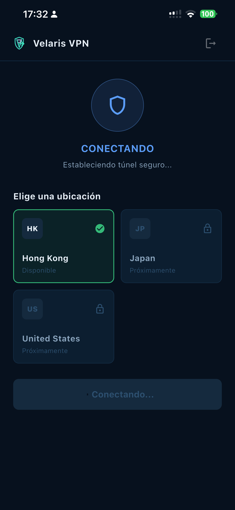
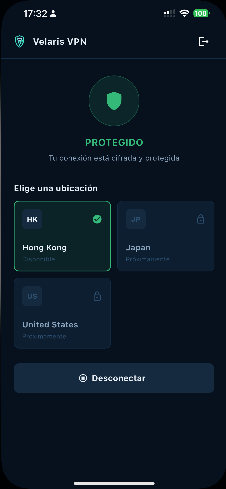
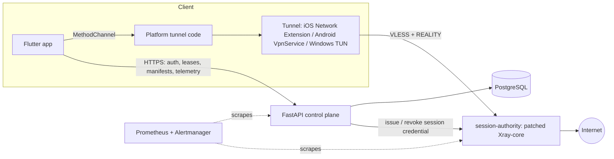

# Velaris — Engineering Case Study

Velaris is a cross-platform VPN client and control plane that I designed and built on my own.
It targets users on networks with heavy internet censorship. This repository is a technical
write-up of the project: the source code and the infrastructure configuration are private.

**Status:** pre-launch. The system runs end to end with a small private beta, including a
tester in mainland China. No payments and no public release yet.
Connectivity from mainland China has been checked manually, not yet systematically across
carriers. The sections below say what has been verified and what is still in progress.

## Overview

A censorship-resistant VPN has two hard parts. The first is the transport: traffic has to
look like ordinary TLS. The second is everything around it: who may connect, from how many
devices, with which short-lived credentials, and how the client recovers on its own when the
network or the operating system gets in the way.

Velaris uses VLESS over REALITY (via Xray-core) for the transport. Most of my work went into
the second part:

- a Flutter client for Android, iOS and Windows, with native tunnel code on each platform;
- an iOS Network Extension written in Swift that enforces the session by itself while the app
  is suspended;
- a FastAPI + PostgreSQL control plane that issues session leases and Ed25519-signed
  connection manifests;
- the server side: a patched Xray-core build that can revoke live connections, monitoring and
  alerting, backups, and a simulated multi-hop data plane.

I was responsible for the whole stack: product design, client, native code, backend, server
operations and testing. A large part of the implementation was written with AI coding agents
(Claude Code), under my direction and review.

## Screenshots

  
  &nbsp;&nbsp;
  

<em>Home screen during reconnection and once connected. The location list
shows the planned regions; one is enabled during the beta.</em>

## Architecture

Details and a second diagram for iOS are in [docs/architecture.md](docs/architecture.md).

The connection flow:

1. The app authenticates and registers the device.
2. It asks for a **session lease**. At most two leases can be active per entitlement, and the
   limit is enforced atomically in PostgreSQL.
3. It requests a **manifest**: the entry point plus a short-lived credential bound to that
   lease, signed with Ed25519. The client verifies the signature against a pinned, rotatable
   keyset before using it.
4. The native tunnel starts Xray with that credential and sends heartbeats to keep the lease
   alive. When a lease stops being renewed, the backend revokes the credential and the
   server closes the open connections.

## Native iOS integration

The iOS side has two processes that communicate through a small, explicit interface:

- **Runner (the app)** owns the VPN profile through `NETunnelProviderManager`, exposed to
  Dart over a `MethodChannel` (`prepare`, `status`, `health`, `start`, `stop`, `hold`,
  `dataPlane`, `renew`). The profile carries connect-on-demand rules, so iOS restarts the
  tunnel if the extension dies instead of silently routing traffic outside the VPN.
- **The packet tunnel extension** (`NEPacketTunnelProvider`, Swift) runs Xray-core and
  tun2socks inside the extension's memory limit. It sets DNS and IPv6 routes so nothing leaks
  outside the tunnel, and keeps the session alive while the app is suspended: it sends lease
  heartbeats itself, and on a fatal authorization error it enters a *hold* state that blocks
  traffic instead of leaking it.
- App and extension share state through an App Group and talk through
  `sendProviderMessage` / `handleAppMessage`.

The extension handles failures on its own:

- If it ends up in hold without the app asking for it (expired authorization after the device
  slept, a rejected heartbeat, a failed data plane), it acquires a new lease and manifest by
  itself.
- It checks the manifest signature with CryptoKit against the keys the app already validated,
  then swaps the credential in place.
- It retries with backoff, and again when the device wakes up.

There is no Mac in my setup, so the Swift code is built on a cloud CI service (Codemagic), with
a script that checks the signing profiles and entitlements. Builds are installed on a real
iPhone through ad-hoc distribution and TestFlight. Problems on the device are diagnosed with
crash reports the client uploads to the backend, and with system logs captured over USB from
Windows.

## Backend and infrastructure

- **API:** FastAPI with SQLAlchemy and Alembic migrations on PostgreSQL. The main concepts are
  users, entitlements, devices, session leases, connection attempts, monthly usage and
  telemetry events. Connection attempts follow a validated state machine.
- **Security:** the API signs manifests with Ed25519, and a separate root key signs the list
  of manifest keys (keyset). A timer on the server renews the keyset before it expires and
  alerts if it fails. The API also has rate limiting, token revocation and structured JSON
  logs with an allow-list of fields.
- **Data plane:** an Xray-core build with a small patch that tracks active connections per
  user, so a revoked credential also closes its open streams, not only new ones.
- **Operations:** Prometheus, Alertmanager and a custom relay that sends alerts to push
  notifications, with alert rules covering the API, the database, the host and the Xray
  process. Daily database backups with a restore test, and incident runbooks.
- **Target topology (simulated, not deployed):** replaceable *Shield* edge nodes forward
  traffic through WireGuard to a *Core* exit node. I built it in containers and
  verified it end to end, including failover between two Shields.
- **Privacy:** telemetry records connection outcomes, timings, app version, network class and
  carrier (ASN). It never stores browsing destinations, and never keeps the client IP after
  looking up its carrier.

## Engineering challenges

### 1. An iOS tunnel that kept the phone offline for hours

**Symptom:** after a night with the VPN on, the iPhone had no internet and the app was stuck
loading. Restarting the app did not help; only switching VPN profiles did.

**Investigation:** system logs from the device showed the extension had not crashed. When the
app was launched from cold in the morning, its restore logic asked the extension to go into
hold. In hold, DNS still pointed inside the tunnel, so no name resolved, the app itself could
not reach its own API, and because the hold had been requested by the app, the extension's
self-recovery was correctly disabled. Each component behaved as designed, and together they
locked the device offline.

**Fix:**
- The app no longer requests a hold when the extension is still forwarding traffic.
- The app and the extension can now reach the API even when name resolution inside the
  tunnel is unavailable, with TLS still verified against the hostname, so recovery from hold
  no longer depends on DNS.

**Validation:** unit tests on both sides, a CI build on the device, and an overnight test on
the iPhone, which is in progress at the time of writing.

### 2. Keeping a session alive while iOS suspends the app

iOS suspends the app and throttles the extension's timers during long sleeps, so a client
that renews its lease from the app loses it. I moved heartbeats into the extension, made the
server tolerate a bounded gap (lease TTL plus a server-side grace window), and added the
self-recovery path described above. Validated on a real iPhone: the session survived 25+
minutes with the app suspended and switches between Wi-Fi and cellular without losing the
lease. Recovery after a full night of sleep is still being tested.

### 3. Enforcing "two devices at a time" without trusting the client

A boolean `connected` flag cannot survive crashes, dead batteries or lost networks. Velaris
uses leases with a TTL, acquired inside a PostgreSQL transaction with row locks so that two
devices racing for the last slot cannot both get it (covered by concurrency tests). A lease
alone limits only what the API hands out, so the credentials are scoped per session and
expire, and the patched Xray build closes live streams when a credential is revoked. Tested
separately for new and already-open connections.

## Testing and validation

| Area | How it is tested | Status |
|---|---|---|
| Backend | 218 unit and integration tests (`unittest`) | Passing |
| Flutter app | unit and widget tests, static analysis | Passing |
| Android native plugin | JVM unit tests | Passing |
| Monitoring and ops scripts | Python tests, `promtool` rule tests | Passing |
| Android | emulator against the real backend: connect, reconnect, background, system traffic through the tunnel | Verified (no physical device yet) |
| iOS | real iPhone: end-to-end connection, suspended app, Wi-Fi/cellular switches, DNS/IPv6 leak tests | Verified; long-sleep recovery in progress |
| Windows | system-wide tunnel, no leftover processes after a forced kill | Verified; native IPv6 network pending |
| Multi-hop data plane | containerised Shield → WireGuard → Core, with failover | Verified in simulation only |
| Mainland China | my own manual tests during a stay in China, and a beta tester using the iOS app there | Works in manual tests; no systematic multi-carrier testing yet |

In my own tests from mainland China, NordVPN and ExpressVPN did not connect, and Velaris
reached about 90 Mbps against 15–20 Mbps for the other VPNs that did work. This was a single
manual comparison on one network, not a benchmark.

## Technologies

Flutter / Dart · Swift (NetworkExtension, CryptoKit, Network.framework) · Kotlin and C++
(patched forks of the open-source `flutter_vless` Android and Windows plugins) · Python, FastAPI, SQLAlchemy, Alembic, Pydantic ·
PostgreSQL · Xray-core (VLESS, REALITY), patched in Go · WireGuard · HAProxy · nginx · Docker Compose · systemd · Prometheus, Alertmanager, Grafana · Codemagic CI ·
Ed25519 signing.

## Source availability

The application source, server configuration and keys are private, because publishing them
would make the service easier to fingerprint and block. In an interview I can walk through the
code and the architecture, and show the app working on a real device.
