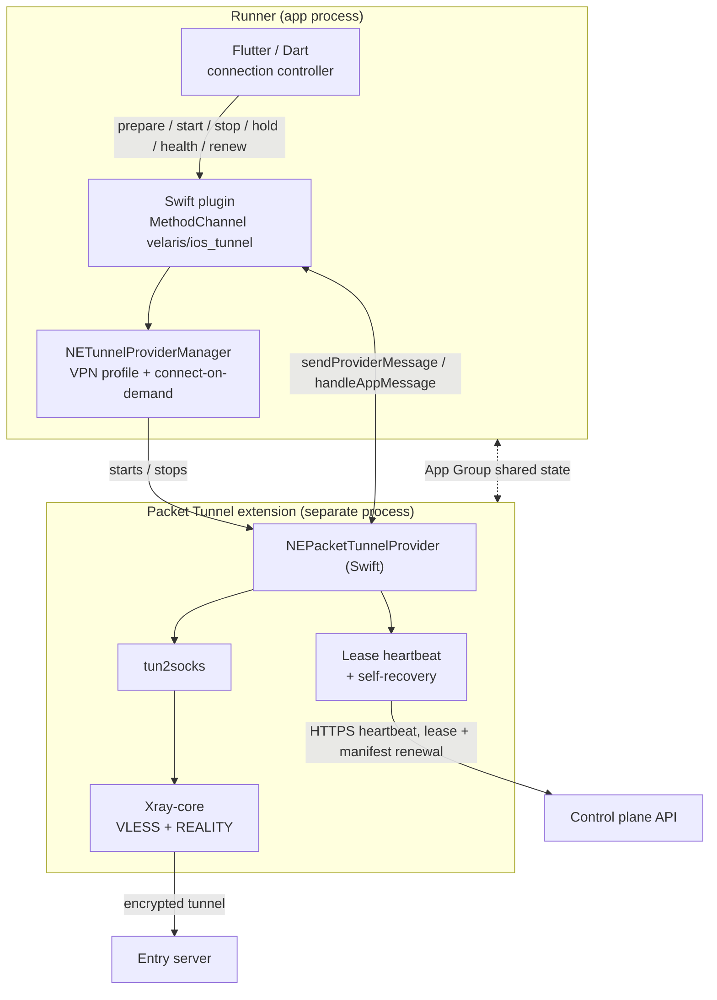
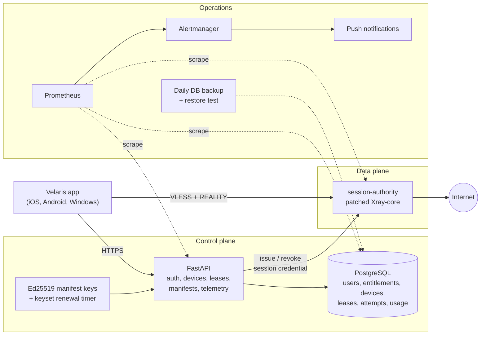
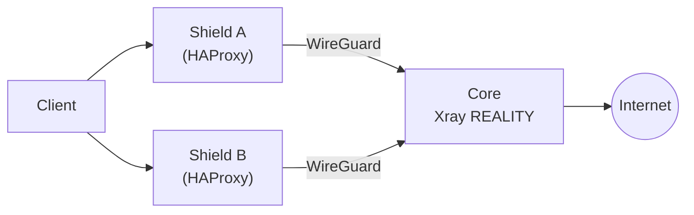

# Architecture

## iOS: from Flutter to the tunnel

Who does what:

- **Dart:** sign-in, choosing a location, getting the lease and manifest, verifying the
  manifest signature, and the UI state machine.
- **Runner plugin:** owns the single VPN profile, the on-demand rules, the session and expiry
  stored in the profile, and health and status queries.
- **Extension:** applies the network settings (routes, DNS, IPv6), runs Xray, enforces the
  session locally, sends heartbeats while the app is suspended, holds traffic on fatal errors,
  and recovers on its own when the app did not ask for the hold.

## Control plane and data plane

## Target topology (simulated only)

The Shields are replaceable edge nodes, and the Core is reachable only through
WireGuard. This topology runs in containers for testing, including failover
between Shields. It has not been deployed on separate servers yet.
